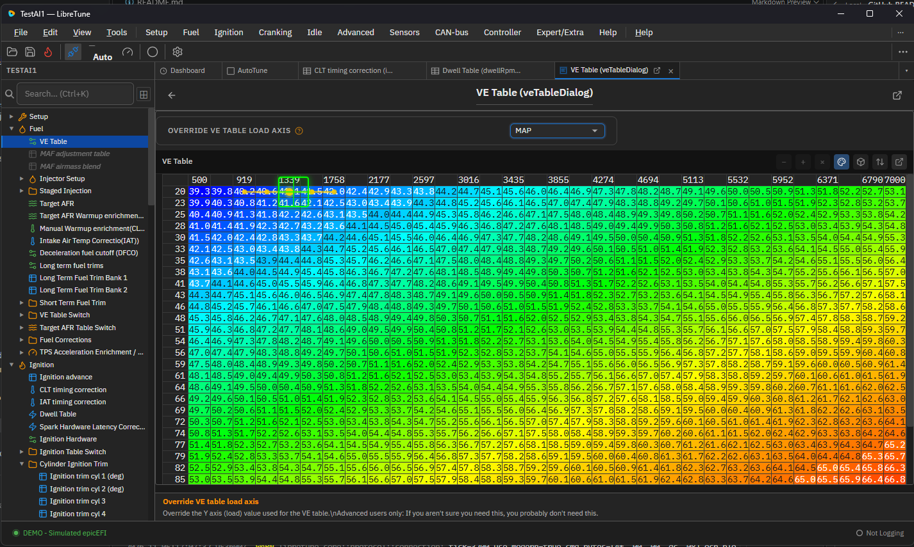
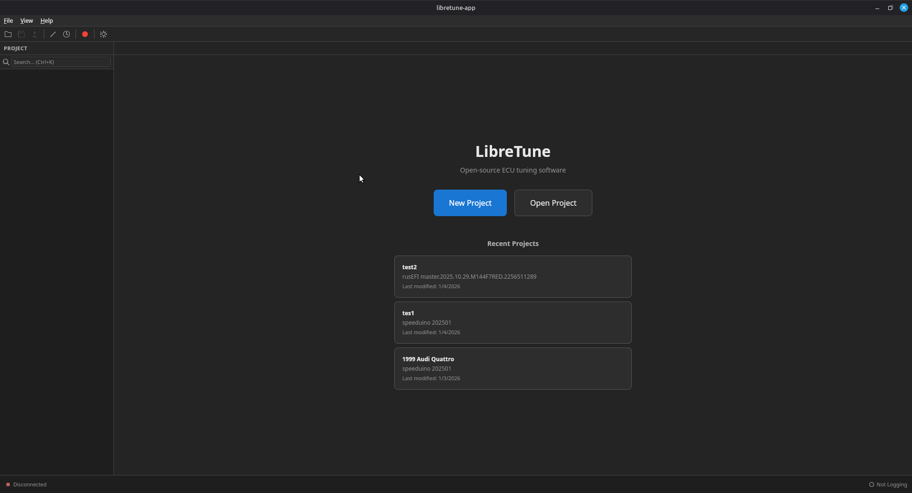
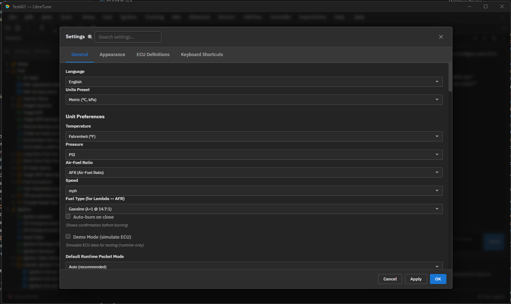
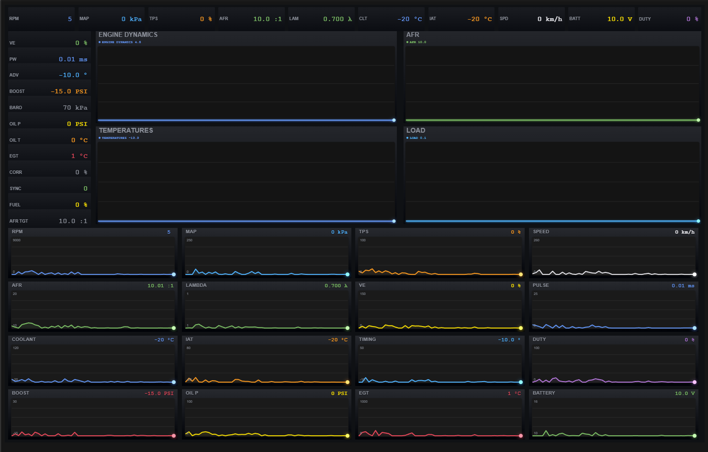
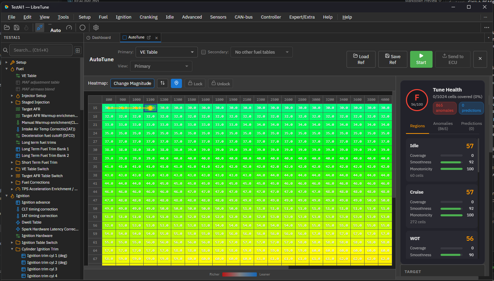
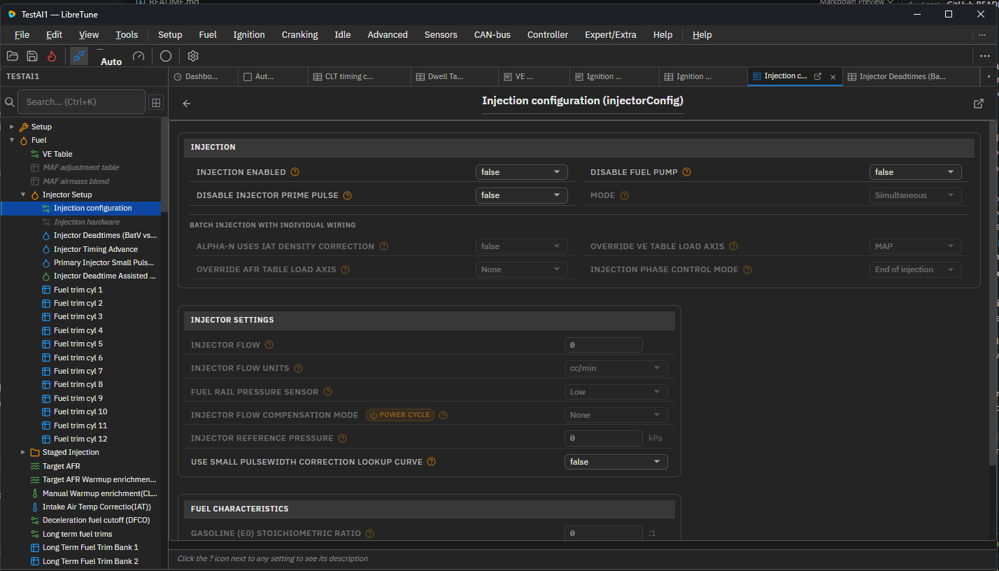

# LibreTune

[](https://www.gnu.org/licenses/old-licenses/gpl-2.0.en.html)
[](https://github.com/RallyPat/LibreTune/actions/workflows/ci.yml)
[](https://github.com/RallyPat/LibreTune/releases/latest)
[](https://github.com/RallyPat/LibreTune/releases/tag/nightly)

[](https://discord.gg/5X7tFUfqCr)

Modern, open-source ECU tuning software for Speeduino, rusEFI, epicEFI, and other INI-compatible aftermarket engine control units. Built with a Rust core and a native desktop UI via Tauri.

> ⚠️ **Pre-release software.** LibreTune is under active development and has not shipped a stable release yet. The [nightly build](https://github.com/RallyPat/LibreTune/releases/tag/nightly) is the recommended way to run it — it is rebuilt whenever there are new commits and published only after the full test suite passes. Expect rough edges, and keep backups of your tunes. Contributions are welcome — see [CONTRIBUTING.md](CONTRIBUTING.md) and the [CHANGELOG](CHANGELOG.md) for what's landed recently.

## Get LibreTune

<!-- No stable release yet. When one ships, add it here and re-add a Stable column to the table below. -->

Download the latest **[nightly build](https://github.com/RallyPat/LibreTune/releases/tag/nightly)** — no compilation required:

| Platform | Download | How to run |
|----------|----------|------------|
| **Linux** | `AppImage` (recommended; `.deb` and `.rpm` also available) | `chmod +x LibreTune-nightly-*.AppImage`, then run it — no install needed |
| **Windows** | Portable `EXE` | Download and run — no installer needed |
| **macOS** | `aarch64` DMG for Apple Silicon (M1+), `x64` DMG for Intel — not universal | Drag **LibreTune** to `Applications`, then see the first-run note below |

<details>
<summary><strong>First-run notes</strong></summary>

- **macOS**: builds are ad-hoc signed but not notarized, so macOS may report the app as damaged or from an unidentified developer. Open **System Settings → Privacy & Security** and click **Open Anyway**, or run:
  ```
  xattr -dr com.apple.quarantine /Applications/LibreTune.app
  ```
- **Windows**: the EXE is unsigned, so SmartScreen may warn on first launch — click **More info → Run anyway**.
- **Linux (AppImage)**: if it will not launch, make sure it is executable and that FUSE is available (most desktop distros ship it).

</details>



## Features

### Base Map Generator
Starting from a blank tune? Describe your engine — cylinders, displacement, injector size, fuel type, aspiration — and LibreTune generates a conservative, driveable starting tune: VE, ignition, and AFR tables plus cranking and warmup enrichment curves. Available from the new-project flow or **Tools → Generate Base Map**; individual tables can also be regenerated in place via the table editor's **Generate…** action.

### Table Editing
Full-featured 2D grid editor with 3D surface visualization, keyboard navigation, and live ECU cursor tracking. Includes Set Equal, Scale, Interpolate, Smooth, Re-bin, Copy/Paste, table comparison, per-table generation, and direct Burn to ECU.

### Dashboards & Gauges
Import existing .dash files or build layouts from scratch with 13 gauge types (analog dials, bar gauges, sweep gauges, digital readouts, line graphs, histograms, tachometers, and more). Drag-and-drop designer mode with three default dashboards included.

### AutoTune
Live fuel table recommendations based on AFR targets with heat map visualization, cell locking, authority limits, transient filtering, lambda delay compensation (fixed, flow-scaled, or measured via the built-in AFR Delay Test), and fuel-cut / railed-sensor exclusion.

### Diagnostics & Logging
Data logger with configurable sample rates, playback controls, CSV import/export, math channels, and alert rules. Tooth logger and composite logger for trigger pattern analysis. Text-based ECU console for rusEFI/FOME/epicEFI.

### Data Management
Project-based workflow with restore points, Git-based tune versioning, CSV export/import, TunerStudio-compatible per-table `.table` import/export, TunerStudio project import, INI version tracking with automatic tune migration, and change annotations. Online INI search from Speeduino, rusEFI, and FOME GitHub repos, offered automatically on ECU signature mismatch.

### Additional
- **AI Assistant**: Bring-your-own-LLM co-pilot (OpenAI / Anthropic / Google / local Ollama or LM Studio, with one-click presets) that reads your tables, realtime data, and datalogs, diagnoses problems, and *proposes* validated, authority-clamped changes for explicit review — applied only after your approval (restore point first) and never burned automatically. OS-keychain API-key storage, capability tiers, pin-conflict warnings, and an "Ask AI" button on every table editor.
- **MCP Server** (local, read-only): expose the same tune-inspection tools to external agents (Claude Code, Claude Desktop, any MCP client) over a loopback HTTP server with bearer auth. Off by default; no tool can edit a tune or touch the ECU.
- **Multi-monitor**: Pop out any tab to its own window with bidirectional sync
- **Unit preferences**: Temperature (°C/°F/K), pressure (kPa/PSI/bar/inHg), AFR/Lambda
- **Performance calculator**: Estimated HP/torque curves and acceleration times
- **Action scripting**: Record and replay tuning actions across tunes, with INI-backed validation
- **Lua scripting**: Sandboxed Lua 5.4 engine for custom calculations, automated test sequences, and advanced data processing (**Tools → ECU Lua Editor**)
- **Extensible**: WASM plugin system with sandboxing and permission model
- **Localization**: i18n scaffold with English, Brazilian Portuguese (`pt-BR`), and Hungarian (`hu-HU`); add new locales under `crates/libretune-app/src/i18n/locales/`
- **Demo mode**: Run the app without an ECU using the bundled simulator (Settings → Enable Demo Mode)

For full documentation, open the in-app manual (**Help → User Manual** — bundled with every build, no internet needed) or read the [architecture overview](docs/architecture.md).

## Screenshots

| Welcome Screen | Settings Dialog | Dashboard |
|:--------------:|:---------------:|:---------:|
|  |  |  |

| AutoTune | ECU Settings | VE Table |
|:--------:|:------------:|:--------:|
|  |  |  |

## Supported ECUs

| ECU | INI Support | Serial Protocol |
|-----|:-----------:|:---------------:|
| **Speeduino** | ✅ | ✅ |
| **rusEFI** | ✅ | ✅ |
| **FOME** | ✅ | ✅ |
| **epicEFI** | ✅ | ✅ |
| **MegaSquirt MS2/MS3** | ✅ | Partial |

Any ECU using the standard INI definition format should be compatible.

## Build from Source

Prefer to compile it yourself? The same procedure works on Windows, macOS, and Linux.

<details>
<summary><strong>Show build instructions</strong></summary>

You will need **Rust (stable)** via [rustup](https://rustup.rs), **Node.js 20+**, and your platform's build dependencies — WebKitGTK packages on Linux, Visual Studio Build Tools on Windows, or the Xcode command-line tools on macOS. The exact lists are in [CONTRIBUTING.md](CONTRIBUTING.md):

```bash
git clone https://github.com/RallyPat/LibreTune.git
cd LibreTune/crates/libretune-app
npm install
npm run tauri dev
```

For an optimized release build, run `npm run tauri build` instead.

</details>

## Project Structure

```
libretune/
├── crates/
│   ├── libretune-core/         # Core Rust library
│   │   └── src/
│   │       ├── ini/            # INI file parsing
│   │       ├── protocol/       # Serial communication
│   │       ├── ecu/            # ECU memory model
│   │       ├── datalog/        # Data logging
│   │       ├── autotune/       # AutoTune algorithms
│   │       ├── tune/           # Tune file management
│   │       ├── dash/           # Dashboard format (incl. layout.rs defaults)
│   │       ├── agent/          # AI assistant orchestrator, tools, safety tiers
│   │       ├── llm/            # LLM provider trait + OpenAI/Anthropic/Google impls
│   │       └── project/        # Project, restore points, Git versioning
│   └── libretune-app/          # Tauri desktop application
│       ├── src/                # React frontend (TypeScript)
│       │   ├── components/     # UI (dialogs, dashboards, gauges, tuner-ui, …)
│       │   ├── contexts/       # Cross-cutting React providers
│       │   ├── hooks/          # Reusable hooks (realtime, ECU events, …)
│       │   ├── i18n/           # Localization (en, hu-HU, pt-BR)
│       │   └── stores/         # State stores
│       └── src-tauri/          # Tauri backend (Rust)
│           └── src/
│               ├── commands/   # Tauri commands (~80 topic modules)
│               └── state.rs    # Shared AppState
├── docs/                       # User manual (mdBook) + architecture.md
├── scripts/                    # Build and development scripts
├── CHANGELOG.md                # Keep-a-Changelog history
└── Cargo.toml                  # Workspace root
```

For a deeper dive into module boundaries and Phase 1–8 cleanup history, see [docs/architecture.md](docs/architecture.md) and [CHANGELOG.md](CHANGELOG.md).

## Development

See [CONTRIBUTING.md](CONTRIBUTING.md) for development setup and guidelines, and [docs/architecture.md](docs/architecture.md) for a tour of the codebase.

### Tests

```bash
# Rust workspace
cargo test --workspace

# Frontend (vitest)
cd crates/libretune-app && npm run test:run
```

### Lints & type checks

```bash
cargo clippy --workspace --all-targets -- -D warnings
cargo fmt --all -- --check

cd crates/libretune-app
npm run typecheck
```

The full pre-push pipeline (build + tests + clippy + fmt + frontend build/tests) is wrapped in [scripts/pre-push.sh](scripts/pre-push.sh). Both Git hooks are opt-in: `scripts/setup-git-hooks.ps1` (or `.sh`) enables the pre-commit format check, and `./scripts/pre-push.sh --install-hook` runs the full pipeline before every push.

## License

This program is free software; you can redistribute it and/or modify it under
the terms of the GNU General Public License version 2 as published by the Free
Software Foundation.

See [LICENSE](LICENSE) for the full license text.

## Contributing

Contributions are welcome! Please read [CONTRIBUTING.md](CONTRIBUTING.md) before submitting PRs.

## Acknowledgments

LibreTune is an independent open-source project and is not affiliated with EFI Analytics.
